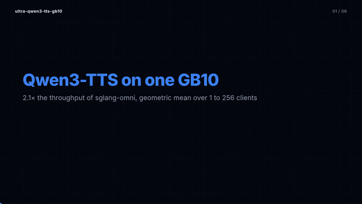
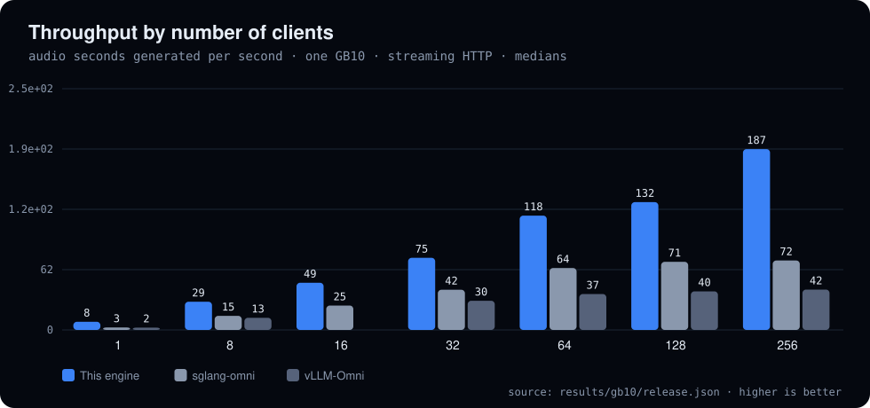

<div align="center">


# 🔊 ultra-qwen3-tts-gb10

**Streaming Qwen3-TTS on one NVIDIA GB10, at 2.1× the throughput of sglang-omni.**

[](LICENSE)  

[📈 Results](#results) · [🎧 Does it keep up with playback?](#playback) · [🧩 How it works](#how-it-works) · [🎯 Accuracy](#accuracy) · [🚀 Quick start](#quick-start) · [⚠️ Honest caveats](#caveats) · [🗺️ Repo map](#repo-map)

</div>

---

**Launch video: how it works, throughput, playback gaps. Click for the mp4.**

[](assets/launch.mp4)

ultra-qwen3-tts-gb10 is a streaming inference engine for
[Qwen3-TTS-12Hz-1.7B](https://huggingface.co/Qwen/Qwen3-TTS-12Hz-1.7B-CustomVoice) on the NVIDIA GB10. It is Python and Triton on
PyTorch, with a Go gateway that streams raw PCM over HTTP. Decode on this chip is limited by its 273 GB/s of unified memory, so most of
the work goes into reading fewer bytes per step.

<a id="results"></a>

## 📈 Results

One GB10, Qwen3-TTS-12Hz-1.7B CustomVoice, streaming HTTP. Every server ran alone on the same box with the same multi-process client,
each client sending requests back to back: three runs at 8 to 64 clients, two at 128 and 256, and one run of three requests at 1 client.
vLLM-Omni 0.32 and sglang-omni 0.2 ran at their default limits ([setups](docs/benchmarks.md#competitor-setups)).

**First byte and voice heard, median in ms (lower is better)**

| Clients | First byte, this engine | sglang-omni | vLLM-Omni | Voice heard, this engine | sglang-omni | vLLM-Omni |
| ---: | ---: | ---: | ---: | ---: | ---: | ---: |
| 1 | 32 | 79 | 56 | 42 | 89 | 873 |
| 8 | 78 | 104 | 109 | 88 | 114 | 1,029 |
| 16 | 79 | 115 | - | 91 | 125 | - |
| 32 | 88 | 94 | 166 | 104 | 205 | 1,875 |
| 64 | 92 | 101 | 267 | 164 | 260 | 3,146 |
| 128 | 230 | 4,634 | 10,407 | 316 | 4,770 | 13,421 |
| 256 | 324 | 4,921 | 31,275 | 415 | 5,114 | 34,292 |

<sub>Source: `results/gb10/release.json`</sub>

<p align="center"></p>

"Voice heard" is when a listener hears speech: the first byte, plus any stall, plus the silence a clip opens with.

- ✅ **Throughput:** 1.8× to 3.3× sglang-omni, and 3.1× vLLM-Omni as a geometric mean over the loads measured.
- ✅ **Every request completed.** sglang-omni rejected 67 of 768 at 128 clients and 856 of 1,536 at 256, at its default queue limit.
- ❌ **Behind:** real-time factor at 256 clients, 0.98 against 0.84 on the requests sglang-omni kept.
- 🧪 **Not measured:** vLLM-Omni at 16 clients, and more than one GB10.

<a id="playback"></a>

## 🎧 Does it keep up with playback?

Up to 128 clients a small client buffer hides the gaps. At 256 the engine generates at real time with no headroom, so 62% of
requests have a late chunk, by 86 ms at p90.

<p align="center"></p>

<a id="how-it-works"></a>

## 🧩 How it works

FP8 weights halve what each step streams from memory, batched attention reads only each stream's own live KV, and the codec decoder's stages are
fused into single kernels. Details: [docs/techniques.md](docs/techniques.md).

<p align="center"></p>

<p align="center"></p>

<p align="center"></p>

<a id="accuracy"></a>

## 🎯 Accuracy

Word error rate through each system's own server on one GB10, with final default settings: the same 300 LibriSpeech test-clean texts, four runs at
each of 32 and 64 clients, 2,400 clips from this engine, scored with Whisper large-v3 ([intervals](docs/benchmarks.md#accuracy-through-the-server)).

| System | WER | Excluding garbled clips | Garbled clips |
|---|---:|---:|---:|
| This engine | 2.46% | 1.91% | 9 |
| sglang-omni 0.2 | 1.96% | 1.87% | 3 |
| vLLM-Omni 0.32 | 2.93% | 1.97% | 3 |

A garbled clip has more than half its words wrong.

- 🟰 **Level** on ordinary clips, where all three agree within the interval.
- ❌ **Behind** sglang-omni on overall WER, by 0.50 points (95% interval 0.07 to 1.04), because this engine made more garbled clips in this test.

<a id="quick-start"></a>

## 🚀 Quick start

**On a GB10, in the NGC PyTorch 25.10 container ([setup](docs/running.md))**

```bash
(cd gateway && go build -o uqt-gw .)
UQT_NO_PDL=1 python -m uqt.engine_proc --sock /tmp/uqt.sock --max-slots 256 --max-len 512 --weights hyb &
./gateway/uqt-gw -sock /tmp/uqt.sock -addr 127.0.0.1:8091 &
curl -s http://127.0.0.1:8091/v1/audio/speech -H "Content-Type: application/json" \
  -d '{"input": "Hello from one GB10.", "voice": "Ryan", "language": "English"}' > out.pcm
```

<a id="caveats"></a>

## ⚠️ Honest caveats

- One box, one model variant and one voice. Throughput between runs at 64 clients ranged from 88 to 122 audio-s/s.
- sglang-omni at 1, 128 and 256 clients and vLLM-Omni were measured two days before the other runs, on the same machine.
- The first start compiles and captures every kernel and graph and takes many minutes with hybrid weights.
- sglang-omni needs a one-line patch to start on GB10, because one of its Triton kernels exceeds the chip's shared memory.

<a id="repo-map"></a>

## 🗺️ Repo map

| Path | What it is |
|---|---|
| `uqt/` | engines, kernels, FP8 weights, streaming codec, engine process |
| `gateway/` | Go streaming gateway |
| `bench/gb10/` | GB10 benchmarks, accuracy checks, profilers |
| `results/gb10/` | raw measurements; release.json is what this page reads |
| `docs/` | running, techniques, benchmarks |
| `tools/release_numbers.py` | raw runs to release.json |

---

<div align="center"><sub>The code predictor and streaming codec decoder are adapted from vLLM-Omni (Apache-2.0). Built at Magni.</sub></div>
