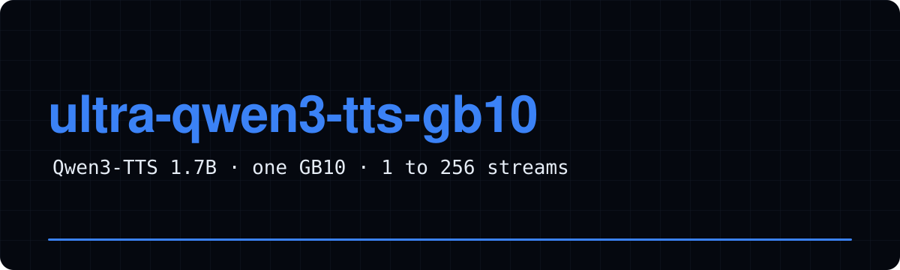
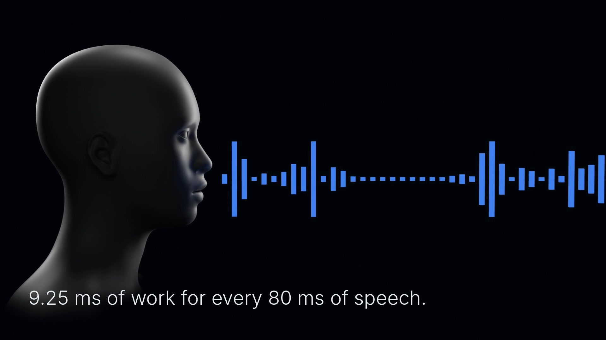
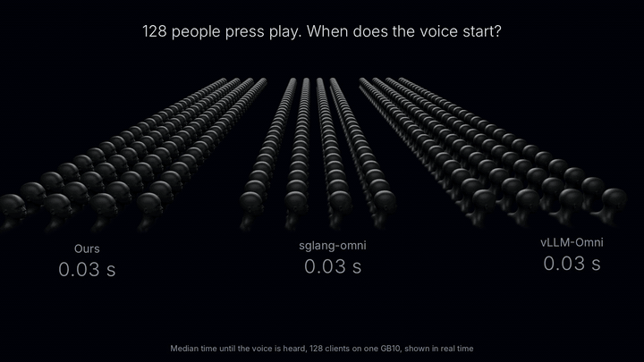
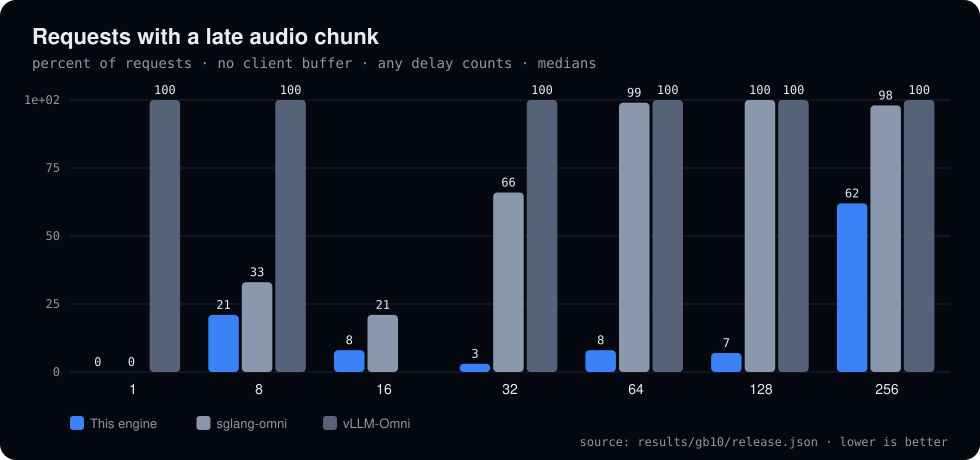
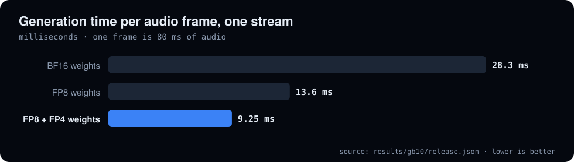
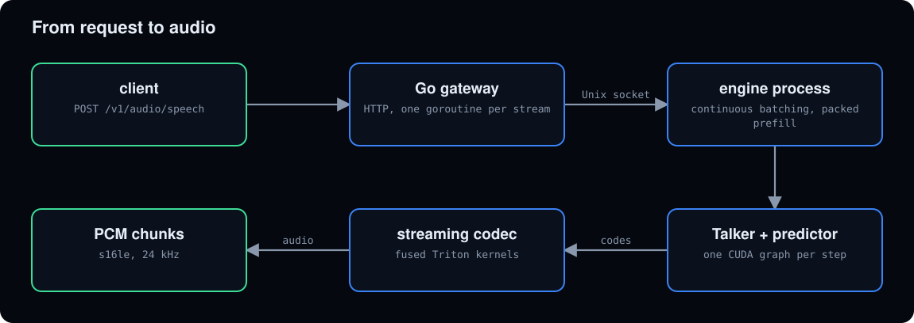
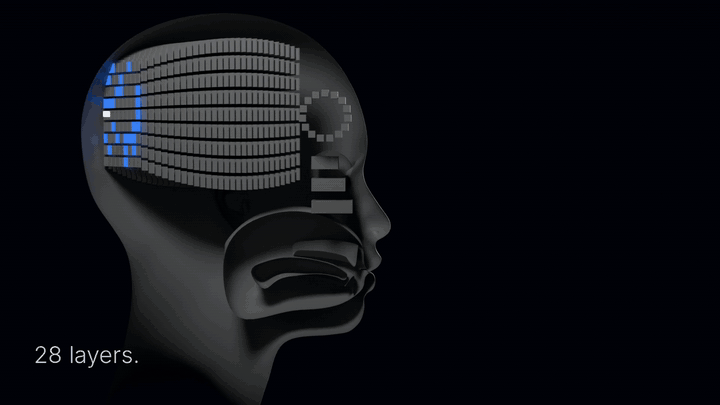

<div align="center">



# 🔊 ultra-qwen3-tts-gb10

**Streaming Qwen3-TTS on one NVIDIA GB10, at 3.1× the throughput of vLLM (vLLM-Omni 0.32).**

[](LICENSE)  

[📈 Results](#results) · [🎧 Does it keep up with playback?](#playback) · [🧩 How it works](#how-it-works) · [🎯 Accuracy](#accuracy) · [🚀 Quick start](#quick-start) · [⚠️ Honest caveats](#caveats) · [🗺️ Repo map](#repo-map)

</div>

---

ultra-qwen3-tts-gb10 is a streaming inference engine for
[Qwen3-TTS-12Hz-1.7B](https://huggingface.co/Qwen/Qwen3-TTS-12Hz-1.7B-CustomVoice) on the NVIDIA GB10. It is Python and Triton on
PyTorch, with a Go gateway that streams raw PCM over HTTP. Decode on this chip is limited by its 273 GB/s of unified memory, so most of
the work goes into reading fewer bytes per step.

[](assets/launch.mp4)

*Launch film (28 s). Click to play. The layer, step and stream counts, the start times and the throughput are the real ones. The last shot's two voices are drawn to the measured 3.1× ratio. The speech, and which tiles light, are illustrative. Made with [`media/film.py`](media/film.py).*

<p align="center"></p>

*128 clients on one GB10, shown in real time. Each crowd lights up at its median time until the voice is heard. vLLM-Omni's is 13.4 s, after the clip ends.*

<a id="results"></a>

## 📈 Results

One GB10, Qwen3-TTS-12Hz-1.7B CustomVoice, streaming HTTP. Every server ran alone on the same box with the same multi-process client,
each client sending requests back to back: three runs at 8 to 64 clients, two at 128 and 256, and one run of three requests at 1 client.
vLLM-Omni 0.32 and sglang-omni 0.2 ran at their default limits ([setups](docs/benchmarks.md#competitor-setups)).

**First byte and voice heard, median in ms (lower is better)**

| Clients | First byte, this engine | sglang-omni | vLLM-Omni | Voice heard, this engine | sglang-omni | vLLM-Omni |
| ---: | ---: | ---: | ---: | ---: | ---: | ---: |
| 1 | 32 | 79 | 56 | 42 | 89 | 873 |
| 8 | 78 | 104 | 109 | 88 | 114 | 1,029 |
| 16 | 79 | 115 | - | 91 | 125 | - |
| 32 | 88 | 94 | 166 | 104 | 205 | 1,875 |
| 64 | 92 | 101 | 267 | 164 | 260 | 3,146 |
| 128 | 230 | 4,634 | 10,407 | 316 | 4,770 | 13,421 |
| 256 | 324 | 4,921 | 31,275 | 415 | 5,114 | 34,292 |

<sub>Source: `results/gb10/release.json`</sub>

<p align="center"></p>

"Voice heard" is when a listener hears speech: the first byte, plus any stall, plus the silence a clip opens with.

- ✅ **Throughput:** 1.8× to 3.3× sglang-omni, and 3.1× vLLM-Omni as a geometric mean over the loads measured.
- ✅ **Every request completed.** sglang-omni rejected 67 of 768 at 128 clients and 856 of 1,536 at 256, at its default queue limit.
- ❌ **Behind:** real-time factor at 256 clients, 0.98 against 0.84 on the requests sglang-omni kept.
- 🧪 **Not measured:** vLLM-Omni at 16 clients, and more than one GB10.

<a id="playback"></a>

## 🎧 Does it keep up with playback?

Up to 128 clients a small client buffer hides the gaps. At 256 the engine generates at real time with no headroom, so 62% of
requests have a late chunk, by 86 ms at p90.

<p align="center"></p>

<a id="how-it-works"></a>

## 🧩 How it works

FP8 weights halve what each step streams from memory, batched attention reads only each stream's own live KV, and the codec decoder's stages are
fused into single kernels. Details: [docs/techniques.md](docs/techniques.md).

<p align="center"></p>

<p align="center"></p>

<p align="center"></p>

<a id="accuracy"></a>

## 🎯 Accuracy

Word error rate through each system's own server, on GB10s of the same model: the same 300 LibriSpeech test-clean texts at
32 and 64 clients, up to 88 runs, scored with Whisper large-v3: 26,400 clips from this engine, 14,400 from sglang-omni and 2,399 from
vLLM-Omni ([intervals](docs/benchmarks.md#accuracy-through-the-server)).

| System | WER | Excluding garbled clips | Garbled clips |
|---|---:|---:|---:|
| This engine | 2.34% | 1.92% | 53 (0.20%) |
| sglang-omni 0.2 | 2.33% | 1.94% | 29 (0.20%) |
| vLLM-Omni 0.32 | 2.93% | 1.97% | 3 (0.13%) |

A garbled clip has more than half its words wrong.

- 🟰 **Level** with sglang-omni: overall WER +0.01 points (95% interval -0.37 to +0.39), 53 garbled clips of 26,400 against 29 of 14,400 (Fisher exact p = 1.0).
- 🧪 **Small sample:** vLLM-Omni has 2,399 clips, so its overall WER is uncertain (this engine's is 0.47 points lower in the test they shared, 95% interval 2.53 lower to 0.79 higher).
- ℹ️ An earlier 2,400-clip test had this engine behind by 0.50 points (9 garbled clips against 3). That test is part of the numbers above; six times more clips did not repeat the gap.
- 🔧 **Hang fix:** 12,000 of this engine's clips come after a fix for a GPU hang seen with unquantized weights. Those alone score 2.48% with 20 garbled clips, against 2.40% with 26 for sglang-omni in the same test, also no measurable difference.

<a id="quick-start"></a>

## 🚀 Quick start

**On a GB10, in the NGC PyTorch 25.10 container ([setup](docs/running.md))**

```bash
(cd gateway && go build -o uqt-gw .)
UQT_NO_PDL=1 python -m uqt.engine_proc --sock /tmp/uqt.sock --max-slots 256 --max-len 512 --weights hyb &
./gateway/uqt-gw -sock /tmp/uqt.sock -addr 127.0.0.1:8091 &
curl -s http://127.0.0.1:8091/v1/audio/speech -H "Content-Type: application/json" \
  -d '{"input": "Hello from one GB10.", "voice": "Ryan", "language": "English"}' > out.pcm
```

<a id="caveats"></a>

## ⚠️ Honest caveats

- One box, one model variant and one voice. Throughput between runs at 64 clients ranged from 88 to 122 audio-s/s.
- The speed numbers were measured before the hang fix. With and without it, throughput at 32 to 256 clients differed by -2.2% to +0.7%, none of it significant ([details](docs/benchmarks.md#accuracy-through-the-server)).
- sglang-omni at 1, 128 and 256 clients and vLLM-Omni were measured two days before the other runs, on the same machine.
- The first start compiles and captures every kernel and graph and takes many minutes with hybrid weights.
- sglang-omni needs a one-line patch to start on GB10, because one of its Triton kernels exceeds the chip's shared memory.

<a id="repo-map"></a>

## 🗺️ Repo map

| Path | What it is |
|---|---|
| `media/film.py` | the launch film |
| `uqt/` | engines, kernels, FP8 weights, streaming codec, engine process |
| `gateway/` | Go streaming gateway |
| `bench/gb10/` | GB10 benchmarks, accuracy checks, profilers |
| `results/gb10/` | raw measurements; release.json is what this page reads |
| `docs/` | running, techniques, benchmarks |
| `tools/release_numbers.py` | raw runs to release.json |

---

<div align="center"><sub>The code predictor and streaming codec decoder are adapted from vLLM-Omni (Apache-2.0). Built at Magni.</sub></div>
